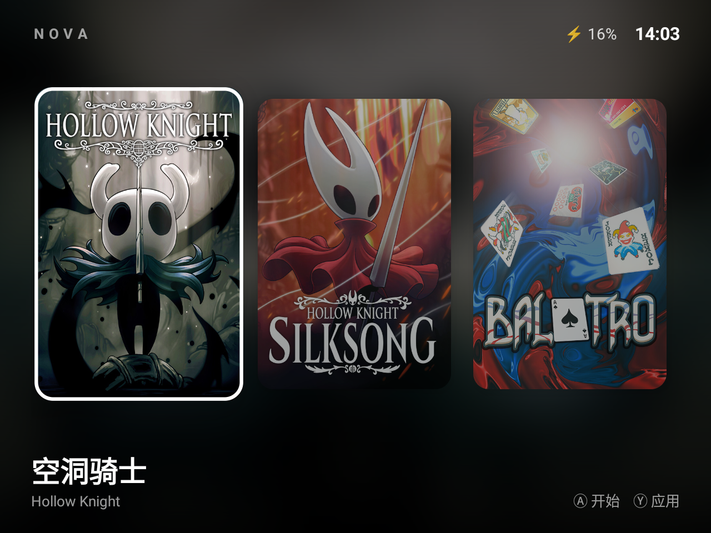
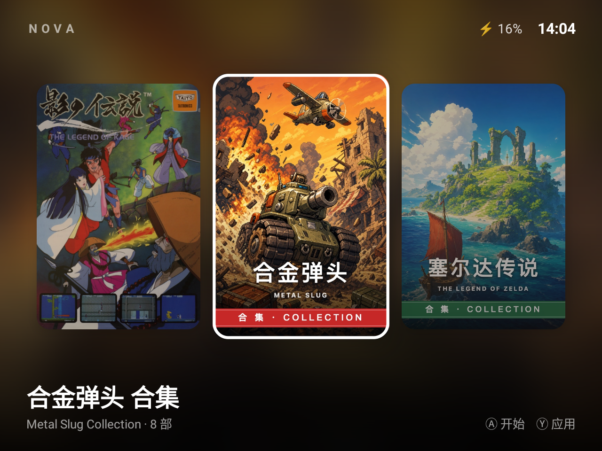
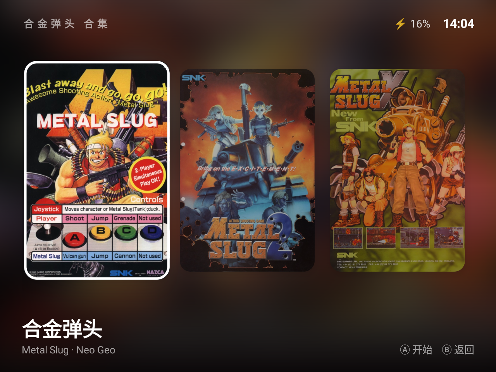
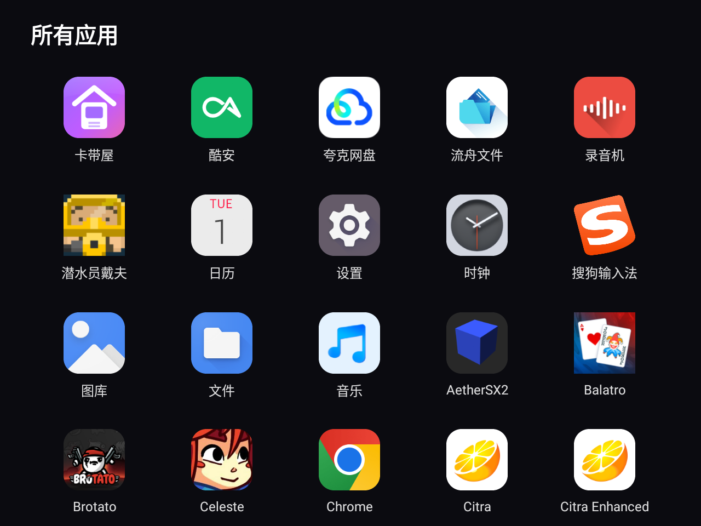

# Nova Launcher

A lightweight big-card game launcher for the Retroid Pocket Nova (Android 13, 1280x960). It is plain Java with no AndroidX and no Gradle, and the APK is under 30 KB. It can be set as the default home screen.



## Features

- Full-bleed 2:3 cover cards, three on screen, with a blurred background of the selected cover.
- Configured with a JSON file and a covers folder on the device, with no rebuild needed.
- Native Android games, RetroArch games (ROM and core passed through the launch intent) and standalone Dolphin (GameCube) games.
- Collections open a second-level page. Examples are the Metal Slug and Zelda series.
- Gamepad-first controls: Ⓐ starts a game, Ⓑ goes back, Ⓨ opens the app drawer. The selected card is remembered.
- A clock and battery level in the header. Games that aren't installed are greyed out.







## Build

Requires the Android SDK (`build-tools/36.0.0`, `platforms/android-37.0`) and JDK 17+.

```sh
./build.sh                              # build/nova-launcher.apk
ANDROID_SERIAL=<serial> ./build.sh install  # install and start
adb shell cmd package set-home-activity dev.nova.launcher/.MainActivity
```

## Configuration

Games and covers are read from shared storage, so you can edit them without rebuilding:

```
/sdcard/Nova/games.json      card list (order = card order)
/sdcard/Nova/covers/<key>.jpg  600x900 cover art (.png/.webp also work)
```

On first launch Nova asks for "All files access" (needed to read `/sdcard/Nova`). If `games.json` doesn't exist, it writes one listing the installed apps Android classifies as games. Changes are picked up the next time you return to the home screen. If the file doesn't parse, Nova shows the error and falls back to the installed games.

```json
{
  "games": [
    { "title": "空洞骑士", "subtitle": "Hollow Knight", "package": "org.nx2a.t0100633007d48000" },
    { "title": "恐龙快打", "subtitle": "Cadillacs and Dinosaurs · Arcade", "cover": "dino",
      "retroarch": { "rom": "/storage/emulated/0/ROMs/arcade/dino.zip", "core": "fbneo" } },
    { "title": "风之杖", "subtitle": "The Wind Waker · GameCube", "dolphin": "/storage/emulated/0/ROMs/gc/Zelda_Wind_Waker.gcz" },
    { "title": "合金弹头 合集", "subtitle": "Metal Slug Collection", "cover": "metal_slug_collection",
      "games": [ /* cards on the collection page */ ] }
  ]
}
```

| Field | Meaning |
| --- | --- |
| `title`, `subtitle` | Card text. |
| `package` | App to launch. Optional for `retroarch` (default `com.retroarch.aarch64`), `dolphin` (default `org.dolphinemu.dolphinemu`) and collections. |
| `retroarch` | `{ "rom", "core" }`, where `core` is the libretro core name without `_libretro_android.so` (e.g. `fbneo`, `mgba`, `pcsx_rearmed`). |
| `dolphin` | ROM path; standalone Dolphin boots it via `AutoStartFile`. |
| `activity`, `extras` | Launch any activity of `package` with string extras. |
| `games` | Makes the card a collection with its own page. |
| `cover` | Cover key in `covers/`. Defaults to the ROM file name without extension, else the package name. Without a cover the card shows the app icon. |

[`examples/Nova`](examples/Nova) is a full setup with covers. Install it with `adb push examples/Nova/. /sdcard/Nova/`.

`tools/crop.swift` crops artwork to 600x900. `tools/title.swift` draws the title and "合集" obi band on collection covers. [CLAUDE.md](CLAUDE.md) has the full guide to emulator cores, getting ROMs, and the cover-art rules.
